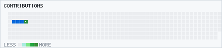

<picture>
  <source media="(prefers-color-scheme: dark)" srcset="https://raw.githubusercontent.com/Duzng510/Duzng510/main/assets/banner-dark.svg">
  
</picture>

# Duzng510

<picture>
  <source media="(prefers-color-scheme: dark)" srcset="https://readme-typing-svg.demolab.com?font=Press+Start+2P&size=16&duration=3200&pause=900&color=00D1FF&center=true&vCenter=true&repeat=true&width=680&height=40&lines=IT+student.+Sofa+enjoyer.%3BI+prompt%2C+the+model+commits.%3BReviewing+AI+code+until+it%27s+boring.%3BPeak+commit+hour%3A+05%3A00+local.%3BEndeavourOS+%2B+Hyprland.+Arch+btw.%3B111+commits%2C+29+PRs%2C+still+learning.">
  
</picture>

<picture>
  <source media="(prefers-color-scheme: dark)" srcset="https://komarev.com/ghpvc/?username=Duzng510&style=flat-square&color=00d1ff">
  
</picture>

## 🛋️ About

- 🌱 IT student, currently living inside the vibe-code loop: prompt → patch → review → repeat
- 🤖 I describe the outcome, the model writes it, I read the diff until it stops surprising me
- 🐧 EndeavourOS + Hyprland, dual-booted with Windows because some tooling still demands it
- 📦 111 commits and 29 merged PRs across 3 public repos
- 🛋️ my bio says "i tried so hard and got sofa", and that is still the accurate project status

## ⌨️ The loop

<picture>
  <source media="(prefers-color-scheme: dark)" srcset="https://raw.githubusercontent.com/Duzng510/Duzng510/main/assets/log-dark.svg">
  
</picture>

## 🏆 By the numbers

<picture>
  <source media="(prefers-color-scheme: dark)" srcset="https://raw.githubusercontent.com/Duzng510/Duzng510/main/assets/trophy-strip-dark.svg">
  
</picture>

## 📊 GitHub stats

<table>
  <tr>
    <td align="center" width="50%">
      <picture>
        <source media="(prefers-color-scheme: dark)" srcset="https://github-readme-stats.vercel.app/api?username=Duzng510&show_icons=true&bg_color=0b1020&border_color=223252&title_color=00d1ff&icon_color=ef7d57&text_color=d7e8ff">
        
      </picture>
    </td>
    <td align="center" width="50%">
      <picture>
        <source media="(prefers-color-scheme: dark)" srcset="https://streak-stats.demolab.com/?user=Duzng510&background=0b1020&border=223252&stroke=d7e8ff&ring=00d1ff&fire=ef7d57&currStreakNum=00d1ff&sideNums=d7e8ff&sideLabels=d7e8ff&dates=8c959f">
        
      </picture>
    </td>
  </tr>
  <tr>
    <td align="center" colspan="2">
      <picture>
        <source media="(prefers-color-scheme: dark)" srcset="https://github-readme-stats.vercel.app/api/top-langs?username=Duzng510&layout=compact&langs_count=8&bg_color=0b1020&border_color=223252&title_color=00d1ff&icon_color=ef7d57&text_color=d7e8ff">
        
      </picture>
    </td>
  </tr>
  <tr>
    <td align="center" colspan="2">
      <picture>
        <source media="(prefers-color-scheme: dark)" srcset="https://raw.githubusercontent.com/Duzng510/Duzng510/main/assets/grid-snake-dark.svg">
        
      </picture>
    </td>
  </tr>
</table>

## 🧰 Stack

<!-- TODO: tự thêm badge vào dòng dưới, ví dụ:

Chạy `node tools/gen-assets.mjs` nếu đổi palette, không cần sửa tay file SVG.
-->

## 🌐 Find me

> 🛋️ *i tried so hard and got sofa*

<!--
Asset trong assets/ sinh ra bởi tools/gen-assets.mjs (palette: tools/palette.mjs,
font 5x7: tools/font.mjs). Muốn số liệu mới: node tools/gen-assets.mjs --refresh
rồi commit. Kiểm chứng asset: node tools/check-assets.mjs
-->
